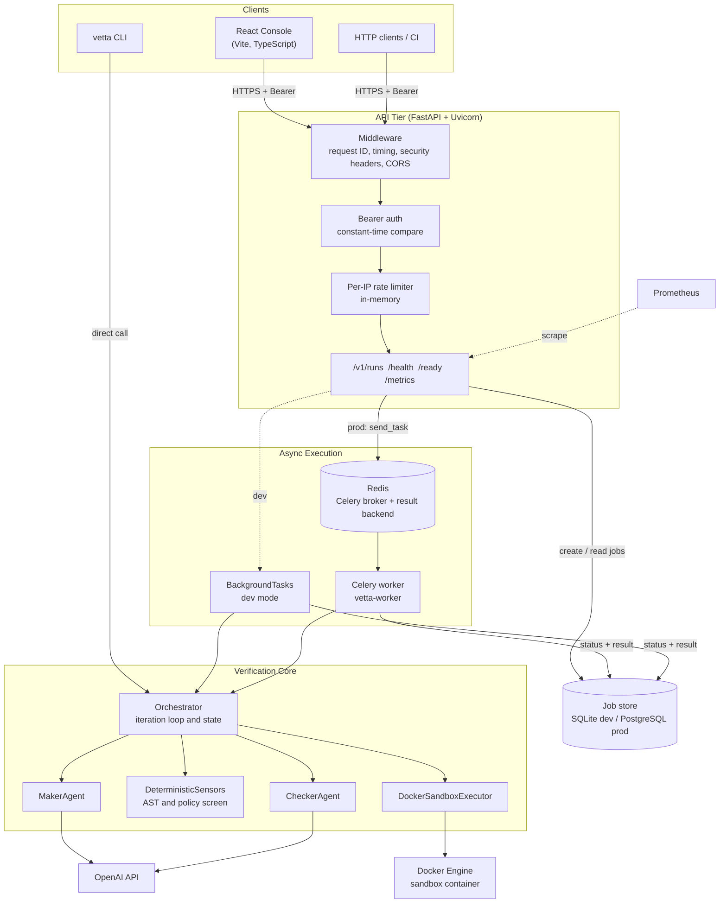
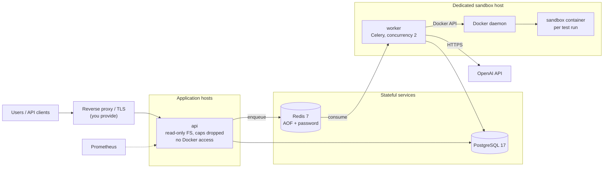
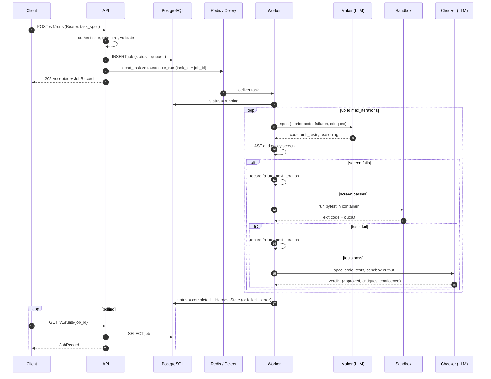
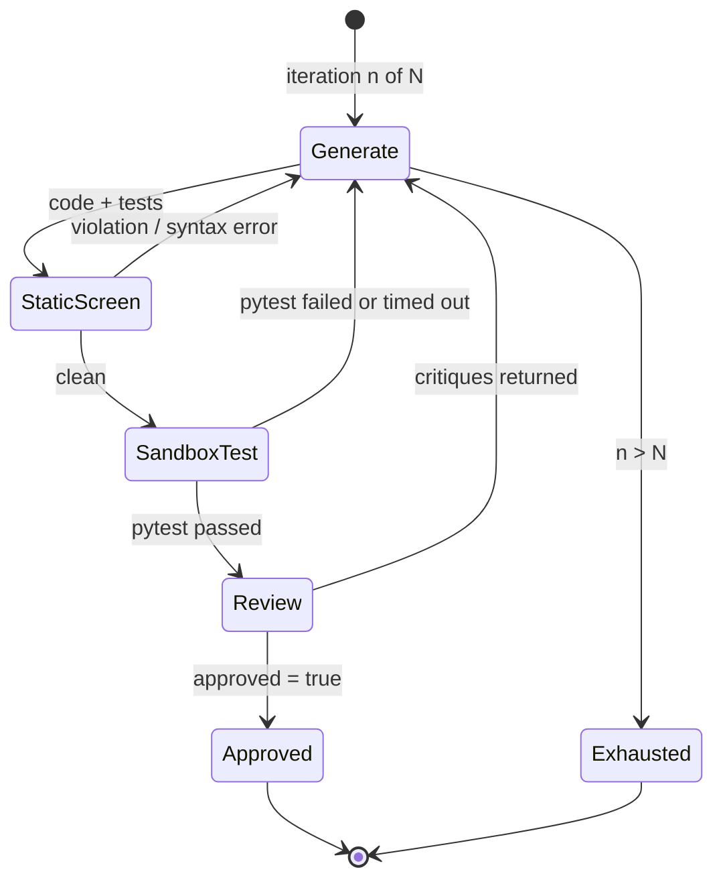
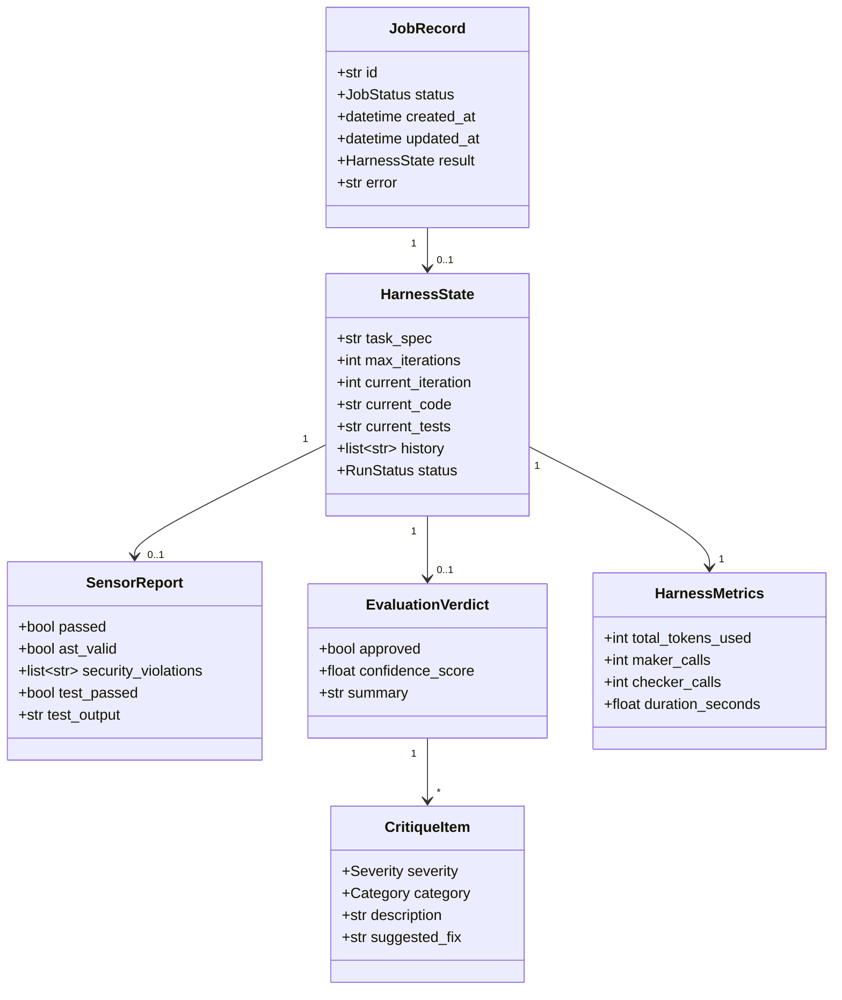
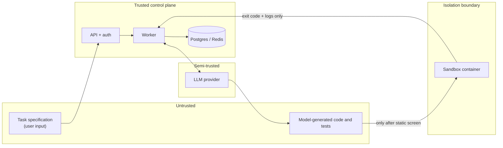
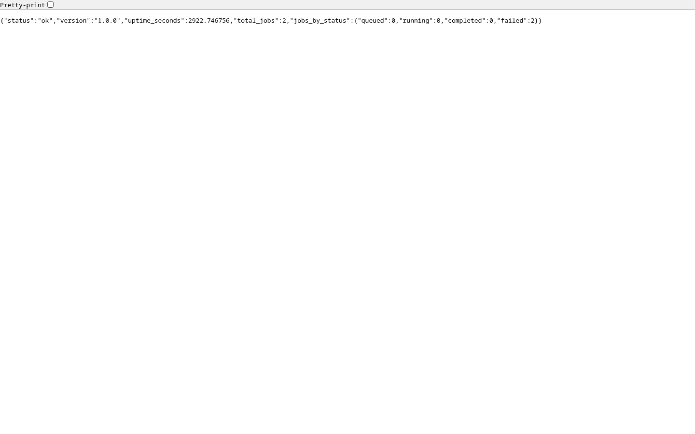

# Vetta

<div align="center">

**An adversarial verification harness for AI-generated Python: generate, screen, sandbox-test, and independently review.**

[](.github/workflows/ci.yml)
[](https://www.python.org/)
[](https://fastapi.tiangolo.com/)
[](https://react.dev/)
[](https://www.postgresql.org/)
[](https://redis.io/)
[](https://www.docker.com/)

</div>

Vetta turns a natural-language specification into a Python implementation plus pytest tests, then
refuses to trust either until they have survived three independent gates: a deterministic static
screen, an isolated Docker test run, and a separate reviewer model. Failures at any gate are fed
back to the generator for another attempt, up to a configurable limit.

It ships as a bearer-authenticated REST API, a CLI, and a responsive React console, and runs in two
modes: a single-process development mode (SQLite plus in-process background tasks) and a
distributed production profile (PostgreSQL, Redis, Celery workers).

> **Security notice.** Generated code is untrusted. The AST screen and Docker isolation are
> defense-in-depth measures, not formal verification and not a hardened multi-tenant execution
> platform. See [Security Model](#security-model) and [Known Limitations](#known-limitations).

---

## Table of Contents

1. [Why Vetta](#why-vetta)
2. [Features](#features)
3. [System Architecture](#system-architecture)
4. [System Design](#system-design)
5. [Security Model](#security-model)
6. [Quick Start](#quick-start)
7. [API Reference](#api-reference)
8. [Configuration](#configuration)
9. [Deployment](#deployment)
10. [Observability](#observability)
11. [Project Structure](#project-structure)
12. [Development and Testing](#development-and-testing)
13. [Known Limitations](#known-limitations)
14. [Roadmap](#roadmap)
15. [Screenshots](#screenshots)

---

## Why Vetta

A single LLM asked to write code and its own tests tends to agree with itself: the tests encode the
same misunderstandings as the implementation. Vetta applies separation of duties:

| Role | Responsibility | Trust level |
| --- | --- | --- |
| **Maker** | Writes the solution and its pytest tests | Untrusted |
| **Deterministic sensors** | AST parse, forbidden imports and calls | Trusted, rule-based |
| **Sandbox** | Runs the tests in a locked-down container | Trusted isolation boundary |
| **Checker** | Audits spec compliance, edge cases, concurrency, security | Independent, advisory |

Each gate catches a different class of failure, and every rejection becomes structured feedback for
the next attempt.

## Features

- **Maker/checker separation.** Two distinct model calls with different prompts and, by default,
  different models (`gpt-4o` generates, `o3-mini` reviews).
- **Deterministic static screening.** Rejects syntax errors, imports of `os`, `subprocess`,
  `shutil`, `socket`, and calls to `eval`, `exec`, `compile`, and `__import__`.
- **Isolated test execution.** No network, read-only root filesystem and workspace, all Linux
  capabilities dropped, `no-new-privileges`, non-root user, memory, CPU, and PID limits, hard timeout.
- **Iterative repair loop.** Previous code, sandbox output, and reviewer critiques are fed back to
  the maker until approval or the iteration limit.
- **Structured outputs.** Pydantic schemas for artifacts, sensor reports, verdicts (severity and
  category-tagged critiques, confidence score), and run metrics.
- **Three access paths.** REST API (`/v1/runs`), CLI (`vetta`), and React console.
- **Pluggable execution.** In-process `BackgroundTasks` for development; Celery over Redis for
  production, selected purely by configuration.
- **Pluggable persistence.** SQLite by default; PostgreSQL when `VETTA_DATABASE_URL` is set.
- **Operational endpoints.** `/health`, `/ready`, JSON `/metrics`, and Prometheus
  `/metrics/prometheus`, plus request IDs, timing headers, and security headers.

---

## System Architecture

### Component View



### Layered Responsibilities

| Layer | Module(s) | Responsibility |
| --- | --- | --- |
| Presentation | `frontend/src/App.tsx` | Task entry, connection check, polling, rendering of source, tests, logs, critiques |
| Transport | `vetta/api.py` | HTTP contract, auth, rate limiting, middleware, job submission and retrieval |
| Execution | `vetta/queue.py`, `vetta/worker.py` | Celery configuration and the `vetta.execute_run` task |
| Domain | `vetta/orchestrator.py`, `vetta/agents.py`, `vetta/sensors.py`, `vetta/schemas.py` | The verification loop, model calls, static policy, typed state |
| Isolation | `vetta/sandbox.py`, `docker/sandbox.Dockerfile` | Container lifecycle and the minimal pytest image |
| Persistence | `vetta/jobs.py`, `vetta/postgres_store.py` | Job records (SQLite and PostgreSQL implementations of the same interface) |
| Configuration | `vetta/config.py` | Typed settings from environment and `.env`, with validation |
| Telemetry | `vetta/metrics.py` | Prometheus counters and gauges |

### Deployment Topology (Production Profile)



The key design rule: **only the worker tier touches Docker, and it should run on a host dedicated to
that purpose.** The API tier never mounts the Docker socket.

---

## System Design

### Request Lifecycle (Production)



Submission is **asynchronous by design**. A verification run takes tens of seconds to minutes
(multiple LLM round trips plus container startup), which is far beyond a reasonable HTTP request
timeout. The API therefore returns `202` immediately and clients poll.

### The Verification Loop



The gates are ordered **cheapest and most deterministic first**:

1. **Static screen** costs microseconds and needs no infrastructure.
2. **Sandbox run** costs seconds and one container.
3. **Checker review** costs a second (and typically more expensive) model call, so it only runs on
   code that already passes tests.

This ordering minimizes spend: the expensive reviewer never sees code that a free check could have
rejected.

### Core Data Model



Two distinct status fields exist and should not be confused:

| Field | Values | Meaning |
| --- | --- | --- |
| `JobRecord.status` | `queued`, `running`, `completed`, `failed` | Did the **job infrastructure** finish? |
| `HarnessState.status` | `RUNNING`, `APPROVED`, `FAILED_MAX_RETRIES` | What was the **verification outcome**? |

A job can be `completed` while its result is `FAILED_MAX_RETRIES`: the harness ran correctly and
concluded the code could not be verified. `failed` means an infrastructure or unexpected error
(for example, the OpenAI call raised or Docker was unreachable), and the API returns only a generic
message so internal detail does not leak.

Persistence stores the full `HarnessState` as a single JSON document per job (a `TEXT` column in
SQLite, a `JSON` column in PostgreSQL). This keeps the schema trivial and the result immutable once
written, at the cost of not being queryable by field.

### Execution Modes

| Concern | Development mode | Production mode |
| --- | --- | --- |
| Selected when | `VETTA_BROKER_URL` unset | `VETTA_BROKER_URL` set |
| Job runner | FastAPI `BackgroundTasks` in the API process | Celery worker process |
| Database | SQLite file (`VETTA_DATABASE_PATH`) | PostgreSQL (`VETTA_DATABASE_URL`) |
| Delivery guarantee | None: a crash or restart loses in-flight work | At-least-once (late ack, requeue on worker loss) |
| Horizontal scaling | No | Yes: add workers |
| Docker access needed by | The API process | Workers only |

### Reliability Design

| Mechanism | Setting | Purpose |
| --- | --- | --- |
| Late acknowledgement | `task_acks_late=True` | A task is acked only after it finishes, so a crashed worker's job is redelivered |
| Reject on worker loss | `task_reject_on_worker_lost=True` | Requeue if the worker process is killed mid-task |
| Prefetch of 1 | `worker_prefetch_multiplier=1` | Long tasks are not hoarded by one worker while others sit idle |
| Hard / soft time limit | `900s` / `840s` | Bounds runaway jobs (the soft limit raises first, the hard limit kills) |
| Visibility timeout | `1800s` | Must exceed the task time limit or Redis will redeliver a still-running task |
| Sandbox timeout | `VETTA_SANDBOX_TIMEOUT_SECONDS` (default 30) | Bounds each test run independently |
| Container cleanup | `finally` with `remove(force=True)` | No leaked containers on timeout or error |
| DB connection health | `pool_pre_ping`, `pool_recycle=300` | Survives dropped PostgreSQL connections |
| Task identity | `task_id = job_id` | One job maps to one task, which makes tracing straightforward |

**Delivery semantics.** Because tasks are acknowledged late, a task can run **more than once** after
a worker failure. The consequences are extra LLM spend and a re-run of an idempotent verification;
because the job row is simply overwritten with the final state, duplicate execution does not corrupt
results. The task should be treated as at-least-once, not exactly-once.

### Scalability and Capacity

The system's bottleneck is not the API but **worker throughput**: each run is dominated by LLM
latency and sandbox runtime.

- **API tier** is stateless (state lives in PostgreSQL and Redis) and scales horizontally behind a
  load balancer. The one exception is the rate limiter, which is per-process (see
  [Known Limitations](#known-limitations)).
- **Worker tier** scales by adding processes or hosts. Throughput is roughly
  `workers x concurrency / average_run_seconds`. The default concurrency is 2 per worker process.
- **Backpressure** is provided by the Redis queue: bursts accumulate as `queued` jobs rather than
  overloading workers. There is no hard queue-depth cap, so monitor `queued` in `/metrics`.
- **Cost control** comes from `max_iterations` (1 to 10), the request-size cap on `task_spec`
  (20,000 characters), the per-IP submission limit, and cheapest-gate-first ordering.
- **LLM rate limits** are a shared downstream resource: scaling workers beyond your OpenAI quota
  produces retries and failures, not speed.

### Key Design Decisions

| Decision | Rationale | Trade-off |
| --- | --- | --- |
| Asynchronous `202` + polling | Runs far exceed sane HTTP timeouts | Clients must poll; no push notifications yet |
| Separate maker and checker models | Reduces correlated errors from self-review | Roughly doubles model cost per accepted iteration |
| Static screen before sandbox | Free, deterministic, fast rejection | AST rules are bypassable by determined adversaries (sandbox is the real boundary) |
| Docker per test run | Strong, familiar isolation primitive; cheap to reason about | Container start latency; needs Docker on workers |
| Same code path for CLI, API, worker | `run_harness()` is the single entry point | Settings and credentials are resolved per call |
| SQLite and PostgreSQL behind one interface | Zero-dependency local dev, real DB in prod | Two implementations to keep in sync |
| Whole result as one JSON document | Simple schema, atomic writes | Not queryable by field; large rows for long histories |
| Celery over a custom queue | Mature retry, ack, and time-limit semantics | Heavier dependency than needed for tiny deployments |
| Settings from environment | 12-factor, container friendly | Secrets in env need a secret manager in production |

---

## Security Model

### Trust Boundaries



Model output is treated as hostile. The only thing that ever crosses back out of the sandbox is an
exit code and a text log.

### Defense in Depth

| Layer | Control |
| --- | --- |
| Authentication | Bearer token on `/v1/*`, compared with `hmac.compare_digest` (constant time); `503` if no token is configured rather than failing open |
| Transport | `Strict-Transport-Security` in production; TLS termination is expected at your reverse proxy |
| Browser | `X-Content-Type-Options: nosniff`, `X-Frame-Options: DENY`, `Referrer-Policy: no-referrer`, `Cross-Origin-Opener-Policy: same-origin`; CORS restricted to configured origins, no credentials, `GET`/`POST`/`OPTIONS` only |
| Abuse | Per-IP submission rate limit (`VETTA_REQUESTS_PER_MINUTE`), `X-Forwarded-For` honored only if `VETTA_TRUST_PROXY=true`, input length cap |
| Error handling | Global handler returns a generic `500`; job failures store a generic message, never the exception |
| Static screening | AST parse; forbidden modules (`os`, `subprocess`, `shutil`, `socket`) and builtins (`eval`, `exec`, `compile`, `__import__`) |
| Sandbox | See table below |
| Secrets | `SecretStr` for the API key and token; compose requires secrets via `${VAR:?}` so the stack refuses to start without them |

### Sandbox Controls

| Control | Value |
| --- | --- |
| Network | Disabled |
| Root filesystem | Read-only |
| Workspace mount | Read-only, fresh temp directory per run |
| Scratch space | `/tmp` tmpfs, 64 MB, `noexec,nosuid,nodev` |
| Linux capabilities | All dropped |
| Privilege escalation | `no-new-privileges:true` |
| User | Non-root, UID/GID `10001` |
| Memory | 512 MB |
| CPU | 50% of one core (`cpu_quota=50000` per `100000` period) |
| Processes | 64 PIDs |
| Wall-clock timeout | `VETTA_SANDBOX_TIMEOUT_SECONDS` (1 to 300, default 30) |
| Lifecycle | Container force-removed after every run |

> **Important:** the AST screen is a speed bump, not a wall. Python offers many ways to reach
> forbidden functionality indirectly (`importlib`, `getattr` on builtins, and so on). The sandbox
> container is the real security boundary; treat the static screen as a cheap early filter and a
> signal for the maker model.

---

## Quick Start

### Requirements

- Python 3.11 or newer
- Node.js 22 and npm (for the console)
- Docker Engine running locally
- An OpenAI API key

### 1. Backend

```bash
python -m venv .venv
source .venv/bin/activate            # Windows: .venv\Scripts\activate
python -m pip install -e ".[dev]"
cp .env.example .env                 # then edit it

# Build the sandbox image the API will run tests in
docker build -f docker/sandbox.Dockerfile -t vetta-sandbox:py311 .

vetta-api
```

In `.env`, set `OPENAI_API_KEY` and replace `VETTA_API_TOKEN` with a long random value:

```bash
openssl rand -hex 32
```

The API listens on `http://127.0.0.1:8000`, with interactive docs at `/docs`.

### 2. Frontend

```bash
cd frontend
npm install
npm run dev
```

Open `http://localhost:5173`, paste your bearer token, click **Check API**, and submit a task. In
development, Vite proxies `/health` and `/v1` to `127.0.0.1:8000`. For a separately hosted API,
set `VITE_API_BASE_URL` and add the console's origin to `VETTA_CORS_ORIGINS`.

### 3. Command Line

```bash
python run_harness.py                                        # built-in LRU cache demo
vetta --spec "Implement a thread-safe LRU cache"
vetta --spec-file task.txt --max-iterations 3
```

The CLI prints the final `HarnessState` as JSON and exits `0` only if the result is `APPROVED`,
which makes it usable as a CI gate.

---

## API Reference

All `/v1/*` routes require `Authorization: Bearer <VETTA_API_TOKEN>`. Interactive documentation is
served at `/docs`.

| Method | Path | Auth | Description |
| --- | --- | --- | --- |
| `POST` | `/v1/runs` | Yes | Submit a verification job; returns `202` with a `JobRecord` |
| `GET` | `/v1/runs/{job_id}` | Yes | Fetch job status and result; `404` if unknown |
| `GET` | `/health` | No | Liveness plus database status, version, uptime |
| `GET` | `/ready` | No | Readiness: database, API token, and OpenAI credentials configured |
| `GET` | `/metrics` | No | JSON job counts by status |
| `GET` | `/metrics/prometheus` | No | Prometheus text exposition |

### Submit a Run

```bash
curl -X POST http://127.0.0.1:8000/v1/runs \
  -H "Authorization: Bearer $VETTA_API_TOKEN" \
  -H "Content-Type: application/json" \
  -d '{"task_spec":"Implement a thread-safe LRU cache","max_iterations":3}'
```

| Field | Type | Constraints |
| --- | --- | --- |
| `task_spec` | string | Required, 1 to 20,000 characters |
| `max_iterations` | integer | Optional, 1 to 10; defaults to `VETTA_MAX_ITERATIONS` |

```json
{
  "id": "3f0c1c0e-6a52-4a41-9d6b-1f6a1d2f9a77",
  "status": "queued",
  "created_at": "2026-11-22T10:15:00Z",
  "updated_at": "2026-11-22T10:15:00Z",
  "result": null,
  "error": null
}
```

### Poll for the Result

```bash
curl -H "Authorization: Bearer $VETTA_API_TOKEN" \
  http://127.0.0.1:8000/v1/runs/3f0c1c0e-6a52-4a41-9d6b-1f6a1d2f9a77
```

Poll until `status` is `completed` or `failed`. When `completed`, read `result.status`
(`APPROVED` or `FAILED_MAX_RETRIES`), `result.current_code`, `result.current_tests`,
`result.last_verdict`, `result.history`, and `result.metrics`.

### Status Codes

| Code | Meaning |
| --- | --- |
| `202` | Job accepted |
| `401` | Missing or invalid bearer token |
| `404` | Unknown job ID |
| `422` | Request body failed validation |
| `429` | Submission rate limit exceeded |
| `503` | Server has no API token configured |

### Response Headers

Every response carries `X-Request-ID` (echoed from the request if supplied, otherwise generated)
and `X-Process-Time-ms`, which makes log correlation and latency tracking straightforward.

---

## Configuration

Settings load from environment variables and a local `.env` file. Copy `.env.example` to start.

| Variable | Required | Default | Description |
| --- | --- | --- | --- |
| `OPENAI_API_KEY` | Yes | none | OpenAI credential |
| `VETTA_API_TOKEN` | Yes (API) | none | Bearer token protecting `/v1/*` |
| `VETTA_ENVIRONMENT` | No | `development` | Set to `production` to enable HSTS |
| `VETTA_LOG_LEVEL` | No | `INFO` | Log level |
| `VETTA_CORS_ORIGINS` | No | localhost:5173 | JSON list of allowed browser origins |
| `VETTA_DATABASE_PATH` | No | `data/vetta.sqlite3` | SQLite file (development) |
| `VETTA_DATABASE_URL` | No | none | PostgreSQL URL; when set, overrides SQLite |
| `VETTA_BROKER_URL` | Prod | none | Redis URL; when set, jobs go to Celery |
| `VETTA_RESULT_BACKEND` | No | none | Celery result backend (Redis) |
| `VETTA_MAKER_MODEL` | No | `gpt-4o` | Code-generation model |
| `VETTA_CHECKER_MODEL` | No | `o3-mini` | Review model |
| `VETTA_SANDBOX_IMAGE` | No | `vetta-sandbox:py311` | Image used for test runs |
| `VETTA_SANDBOX_TIMEOUT_SECONDS` | No | `30` | Per-run timeout, 1 to 300 |
| `VETTA_MAX_ITERATIONS` | No | `4` | Default iteration cap, 1 to 10 |
| `VETTA_REQUESTS_PER_MINUTE` | No | `30` | Per-IP submission limit, 1 to 1000 |
| `VETTA_TRUST_PROXY` | No | `false` | Trust `X-Forwarded-For` for client IP (enable only behind a proxy you control) |
| `VITE_API_BASE_URL` | No | empty | Frontend build-time API base URL |

Two things are worth knowing about the Checker: when the model name contains `o1` or `o3` it is
called with `reasoning_effort="medium"`; otherwise it is called with `temperature=0.0`. The Maker
runs at `temperature=0.1`.

---

## Deployment

### Docker Compose (Production Profile)

`docker-compose.enterprise.yml` defines `postgres`, `redis`, `api`, and `worker`.

```bash
export POSTGRES_PASSWORD="$(openssl rand -hex 32)"
export REDIS_PASSWORD="$(openssl rand -hex 32)"
export VETTA_API_TOKEN="$(openssl rand -hex 32)"
export OPENAI_API_KEY="<from your secret manager>"
export VETTA_CORS_ORIGINS='["https://vetta.example.com"]'

docker build -f docker/sandbox.Dockerfile -t vetta-sandbox:py311 .   # on the worker host
docker compose -f docker-compose.enterprise.yml up -d --build
```

The stack refuses to start if any required secret is unset. The API binds to `127.0.0.1:8000` only;
put a TLS-terminating reverse proxy in front of it. The API container runs with a read-only
filesystem, all capabilities dropped, and `no-new-privileges`.

### Hardening Checklist

- [ ] Terminate TLS at a reverse proxy; set `VETTA_ENVIRONMENT=production`.
- [ ] Source secrets from a secret manager, never from committed files or images.
- [ ] Run workers on dedicated hosts or VMs. **Mounting `/var/run/docker.sock` grants the worker
      effective root on that host.**
- [ ] Never mount Docker into the API tier.
- [ ] Never expose the Docker daemon over an unauthenticated TCP socket.
- [ ] Restrict `/metrics` and `/metrics/prometheus` at the proxy (they are unauthenticated).
- [ ] Set `VETTA_TRUST_PROXY=true` only when a trusted proxy sets `X-Forwarded-For`.
- [ ] Back up PostgreSQL; Redis uses AOF persistence but is a queue, not a system of record.
- [ ] Set OpenAI spend limits and alert on token usage.

### Container Images

| Image | Base | Purpose |
| --- | --- | --- |
| `Dockerfile` | `python:3.12-slim` | API and worker; runs as non-root `app` user |
| `docker/sandbox.Dockerfile` | `python:3.11-slim` | Minimal sandbox: `pytest==8.3.5` only, user `10001` |

---

## Observability

| Signal | Source |
| --- | --- |
| Liveness | `GET /health` |
| Readiness | `GET /ready` (returns `degraded` if the DB or credentials are missing) |
| Job counts | `GET /metrics` (`queued`, `running`, `completed`, `failed`, total) |
| Prometheus | `GET /metrics/prometheus` |
| Per-run telemetry | `HarnessMetrics` in each result: tokens, maker calls, checker calls, duration |
| Correlation | `X-Request-ID` header; structured logs in the worker via `structlog` |

Prometheus series: `vetta_jobs_submitted_total`, `vetta_jobs_completed_total`,
`vetta_jobs_failed_total`, `vetta_sandbox_containers`.

**Suggested alerts:** a growing `queued` count (workers saturated or down), a rising `failed` ratio
(OpenAI or Docker trouble), `/ready` returning `degraded`, and token usage per run drifting upward.

---

## Project Structure

```text
.
├── src/vetta/
│   ├── api.py              FastAPI app, auth, middleware, routes
│   ├── orchestrator.py     Verification loop (EnterpriseHarnessOrchestrator, run_harness)
│   ├── agents.py           MakerAgent and CheckerAgent (OpenAI structured outputs)
│   ├── sensors.py          AST and forbidden-pattern screening
│   ├── sandbox.py          DockerSandboxExecutor
│   ├── schemas.py          Pydantic models for state, verdicts, metrics
│   ├── jobs.py             JobRecord and the SQLite JobStore
│   ├── postgres_store.py   SQLAlchemy PostgresJobStore
│   ├── queue.py            Celery app factory and reliability settings
│   ├── worker.py           Celery task vetta.execute_run and vetta-worker entry point
│   ├── metrics.py          Prometheus registry
│   ├── config.py           Settings (pydantic-settings)
│   └── cli.py              `vetta` command
├── frontend/               React 19 + TypeScript + Vite console
├── docker/
│   └── sandbox.Dockerfile  Minimal pytest sandbox image
├── tests/                  API and sensor tests
├── docs/screenshots/       README images
├── Dockerfile              API and worker image
├── docker-compose.enterprise.yml
├── run_harness.py          Run the CLI from a source checkout
└── .github/workflows/ci.yml
```

---

## Development and Testing

```bash
python -m pytest        # backend tests
ruff check .            # lint (E, F, I, UP, B; line length 100)

cd frontend
npm run lint            # oxlint
npm run build           # tsc -b && vite build
```

The test suite uses FastAPI's `TestClient` with an injected `runner` function, so API behavior is
tested **without OpenAI or Docker**. Covered behaviors include authentication, job persistence,
`404` handling, error redaction, health and readiness, CORS, and security headers.

CI (`.github/workflows/ci.yml`) runs the frontend lint and build on Node 22, and the backend lint
and tests on Python 3.11 and 3.12.

---

## Known Limitations

These are documented deliberately so deployments can be planned around them.

| Area | Limitation | Mitigation |
| --- | --- | --- |
| Dev-mode durability | `BackgroundTasks` jobs are lost if the API process restarts | Use the Celery profile for anything non-trivial |
| Rate limiting | In-memory and per process; not shared across API replicas and reset on restart | Enforce limits at the proxy or gateway as well |
| Static screening | Blocklist-based and bypassable by indirect access | Rely on the sandbox as the real boundary |
| Sandbox | Container isolation shares the host kernel; not a substitute for VM-level isolation | Dedicated hosts; consider gVisor or Firecracker for hostile workloads |
| Multi-tenancy | A single shared bearer token; no per-user identity, quotas, or job ownership | Put an authenticating gateway in front, or add per-tenant auth |
| Metrics | `jobs_completed` and `jobs_failed` increment in the worker process, `jobs_submitted` in the API process, so a single `/metrics/prometheus` scrape does not show all three | Scrape workers separately or adopt Prometheus multiprocess or pushgateway patterns |
| Unauthenticated ops endpoints | `/metrics*` and `/health` are open | Restrict at the network layer |
| Feedback loop | When the static screen rejects code, the specific violations are not included in the next maker prompt (only a generic "blocked" message) | See Roadmap |
| Compose worker + Docker socket | The worker creates a temp directory inside its own container and bind-mounts it into a sandbox started by the *host* daemon; that path does not exist on the host, so test execution needs a shared host path or a different file-transfer approach | Run workers directly on the sandbox host, or mount a shared workspace volume at an identical path |
| Result size | Full result stored as one JSON blob | Acceptable at current scale; split if histories grow |
| Model dependence | Output quality and cost depend on OpenAI models and quotas | Pin models via configuration |

---

## Roadmap

- Feed static-screen violations back into the maker prompt
- Replace the in-memory limiter with a Redis-backed one
- Per-tenant API keys, quotas, and job ownership
- Webhook or server-sent-event completion notifications instead of polling
- Push worker metrics (or use multiprocess mode) so all counters are visible
- Wire up OpenTelemetry tracing (`OTEL_EXPORTER_OTLP_ENDPOINT` is accepted by settings but no exporter is configured yet)
- Alembic migrations in place of `create_all`
- Optional stronger isolation backends (gVisor, Firecracker)
- Database-side aggregation for job summary counts
- Additional language runtimes beyond Python

---

## Screenshots

<table>
  <tr>
    <td width="50%" align="center">
      
      <b>Verification Console</b>
    </td>
    <td width="50%" align="center">
      
      <b>Interactive API Documentation</b>
    </td>
  </tr>
  <tr>
    <td width="50%" align="center">
      
      <b>Health Status</b>
    </td>
    <td width="50%" align="center">
      
      <b>Operational Metrics</b>
    </td>
  </tr>
  <tr>
    <td colspan="2" align="center">
      
      <br><b>Mobile-Responsive Console</b>
    </td>
  </tr>
</table>

The console covers task configuration, API connectivity checks, retry controls, live run status,
generated source and tests, sandbox output, reviewer critiques, and execution metrics, and stays
usable from desktop down to mobile widths.
