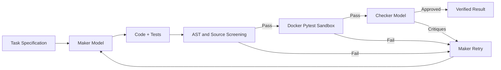
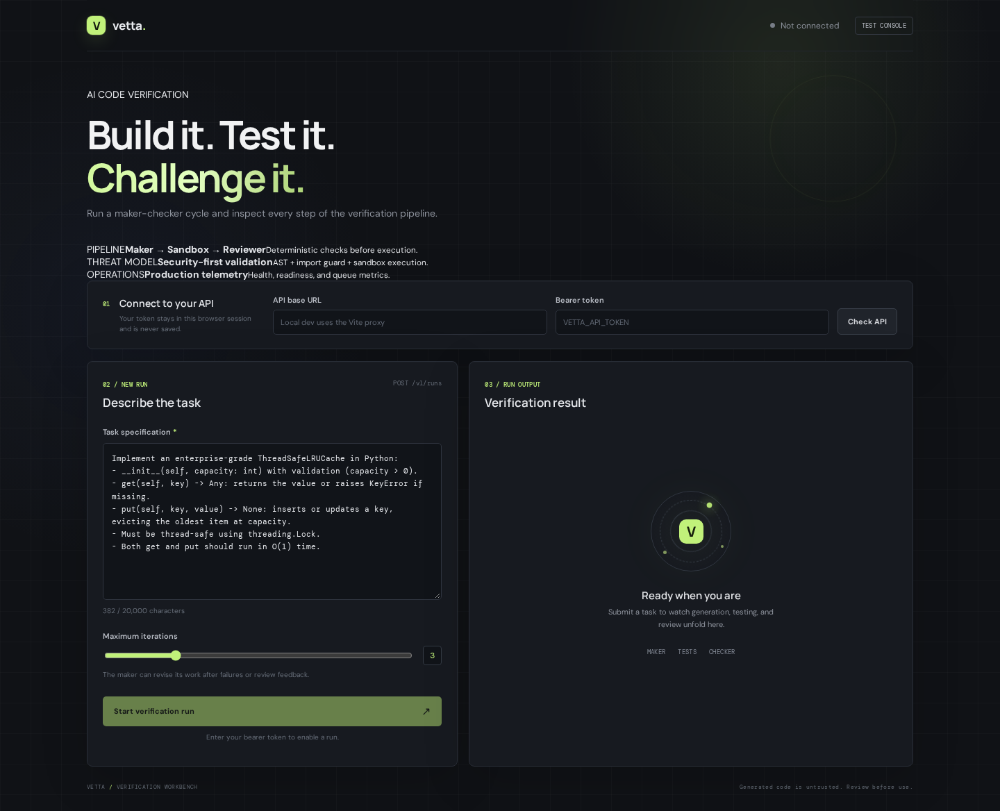
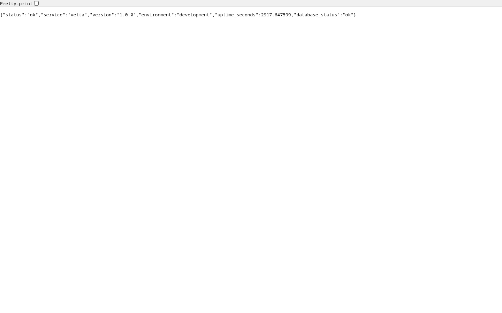
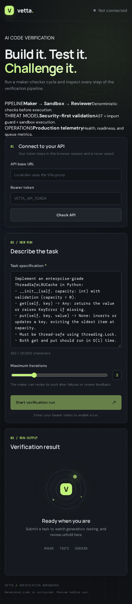

# Vetta

<div align="center">

**AI-assisted Python code generation, verification, sandbox testing, and independent review**

[](https://www.python.org/)
[](https://fastapi.tiangolo.com/)
[](https://react.dev/)
[](https://www.docker.com/)

</div>

Vetta is a full-stack verification harness that converts natural-language specifications into
Python implementations, generates pytest tests, rejects unsafe source patterns, executes the
solution in an isolated Docker container, and submits successful artifacts to an independent
model for final review. It supports authenticated REST API access, a command-line interface,
and a responsive React workbench.

> Generated code is untrusted. Vetta provides advisory safeguards and isolated test execution,
> but AST checks and Docker isolation are not substitutes for formal verification or a hardened
> production worker platform.

## Project Overview

| Area | Implementation |
| --- | --- |
| AI generation | Separate maker and checker model calls |
| Source screening | Python AST validation and forbidden-pattern detection |
| Test execution | Restricted Docker container with pytest |
| Backend | FastAPI, bearer authentication, SQLite or PostgreSQL |
| Queue | FastAPI local tasks or Redis/Celery production workers |
| Frontend | React 19, TypeScript, Vite, responsive console |
| Operations | Health, readiness, JSON and Prometheus metrics |

## Verification Lifecycle



## Core Features

- **Adversarial verification:** Separates code generation from independent review.
- **Deterministic screening:** Rejects syntax errors, selected imports, built-ins, and source patterns.
- **Secure test isolation:** Uses disabled networking, read-only storage, resource limits, process limits,
  dropped capabilities, `no-new-privileges`, and a non-root container user.
- **Iteration management:** Retains history, sensor reports, reviewer critiques, token metrics, and duration.
- **API and CLI access:** Supports `/v1/runs`, bearer authentication, polling, and direct CLI execution.
- **Modern console:** Displays job state, diagnostics, critiques, source artifacts, test logs, and metrics.
- **Production profile:** Supports PostgreSQL, Redis/Celery, separate workers, and Prometheus telemetry.

## Quick Start

### Requirements

- Python 3.11 or newer
- Node.js and npm
- Docker Engine
- OpenAI API key
- Prebuilt `vetta-sandbox:py311` image

### Backend

```bash
python -m venv .venv
source .venv/bin/activate
python -m pip install -e ".[dev]"
cp .env.example .env

docker build -f docker/sandbox.Dockerfile -t vetta-sandbox:py311 .
vetta-api
```

Set `OPENAI_API_KEY` and `VETTA_API_TOKEN` in `.env` before starting the API.
The API runs at `http://127.0.0.1:8000`; interactive documentation is at `/docs`.

### Frontend

```bash
cd frontend
npm install
npm run dev
```

Open `http://localhost:5173`, enter the Vetta bearer token, and use **Check API**.

### Command Line

```bash
python run_harness.py
vetta --spec "Implement a thread-safe LRU cache"
vetta --spec-file task.txt --max-iterations 3
```

## API Usage

```bash
curl -X POST http://127.0.0.1:8000/v1/runs \
  -H "Authorization: Bearer $VETTA_API_TOKEN" \
  -H "Content-Type: application/json" \
  -d '{"task_spec":"Implement a thread-safe LRU cache","max_iterations":3}'
```

Retrieve a run with `GET /v1/runs/JOB_ID` using the same bearer token.

## Demo Screenshots

<table>
  <tr>
    <td width="50%" align="center">
      
      <b>Verification Console</b>
    </td>
    <td width="50%" align="center">
      
      <b>Interactive API Documentation</b>
    </td>
  </tr>
  <tr>
    <td width="50%" align="center">
      
      <b>Health Status</b>
    </td>
    <td width="50%" align="center">
      
      <b>Operational Metrics</b>
    </td>
  </tr>
  <tr>
    <td colspan="2" align="center">
      
      <br><b>Mobile-Responsive Console</b>
    </td>
  </tr>
</table>

<div align="justify">
The console provides task configuration, API connectivity, retry controls, live run status,
generated source and tests, sandbox output, reviewer critiques, and execution metrics. The
interface remains usable across desktop and mobile viewport sizes.
</div>

## Configuration

| Variable | Required | Default | Description |
| --- | --- | --- | --- |
| `OPENAI_API_KEY` | Yes | — | OpenAI API credential |
| `VETTA_API_TOKEN` | Yes for API | — | Bearer token protecting run endpoints |
| `VETTA_DATABASE_PATH` | No | `data/vetta.sqlite3` | SQLite job database |
| `VETTA_MAKER_MODEL` | No | `gpt-4o` | Code-generation model |
| `VETTA_CHECKER_MODEL` | No | `o3-mini` | Review model |
| `VETTA_SANDBOX_IMAGE` | No | `vetta-sandbox:py311` | Locally available sandbox image |
| `VETTA_SANDBOX_TIMEOUT_SECONDS` | No | `30` | Per-test-run timeout (1–300 seconds) |
| `VETTA_MAX_ITERATIONS` | No | `4` | Default maximum iterations (1–10) |

## Sandbox controls

Each test run uses a temporary read-only workspace, disabled networking, a read-only
container filesystem, dropped Linux capabilities, `no-new-privileges`, a non-root
container user, memory/CPU/process limits, and a timeout. The container is removed when
execution finishes. Docker must be configured with the required resource and security
features; do not expose an unauthenticated Docker daemon.

## Enterprise-grade operational hardening

The service is ready for more production-oriented deployments thanks to:

- structured request metadata and trace IDs (`X-Request-ID` and `X-Process-Time-ms`)
- explicit operational health endpoints: `/health`, `/ready`, and `/metrics`
- dependency-aware startup validation for OpenAI credentials, API token, and SQLite readiness
- safe internal error handling that avoids leaking sensitive implementation details
- deterministic CORS configuration for approved frontend origins

## Enterprise deployment

The production profile uses PostgreSQL, Redis/Celery, separate API and worker processes,
Prometheus metrics, and isolated Docker sandbox workers.

```bash
export POSTGRES_PASSWORD="$(openssl rand -hex 32)"
export REDIS_PASSWORD="$(openssl rand -hex 32)"
export VETTA_API_TOKEN="$(openssl rand -hex 32)"
export OPENAI_API_KEY="replace-with-a-secret-manager-reference"
export VETTA_CORS_ORIGINS='["https://vetta.example.com"]'
docker compose -f docker-compose.enterprise.yml up -d --build
```

Keep credentials in a secret manager rather than source-controlled environment files or images.
API containers should not mount Docker; worker containers may use Docker only on dedicated,
isolated hosts. Operational endpoints are `/health`, `/ready`, `/metrics`, and
`/metrics/prometheus`. Start workers with `vetta-worker` and API instances with `vetta-api`.

## Development

```powershell
python -m pytest
```

The API currently runs jobs as FastAPI background tasks in the API process. SQLite
persists job records, but this execution model does not provide durable queue delivery
or horizontal worker scaling. For multi-replica production deployments, move execution
to a separately managed worker queue and use a shared database before scaling out.
